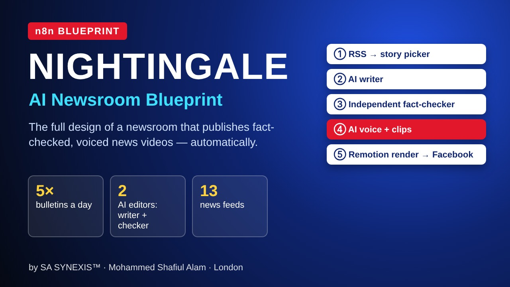

# NIGHTINGALE — AI Newsroom Blueprint (n8n)



**NIGHTINGALE** is an AI newsroom built with **n8n** that publishes **5 fact-checked, voiced news video bulletins a day** to a Facebook news page (SA Media News, London) — fully automatically.

## How it works

```
13 news feeds → story picker → fact pack → AI writer → independent AI fact-checker
   → script clean-up → AI voice + timestamps → stock clips → Remotion render (AWS Lambda) → Facebook
                                    ↑
              Guardian watchdog: safe auto-retry, never double-posts
```

- **Story selection:** 13 feeds, segment quotas (local, immigration, UK, world, sport), trusted-source boost, no repeats.
- **Two-AI editorial desk:** an AI writer plus an independent AI fact-checker that marks every item OK / FIX / DROP.
- **Voice:** ElevenLabs with per-character timestamps for captions.
- **Visuals:** Pexels clips, Remotion template rendered on AWS Lambda via GitHub Actions.
- **Reliability:** a watchdog checks every 10 minutes and safely re-runs failed bulletins.

## Get the blueprint

The full design — architecture, story rules, the complete writer and fact-checker prompts, render and watchdog design, adaptation guide — is a 7-page PDF:

👉 **[NIGHTINGALE — AI Newsroom Blueprint on Gumroad](https://synexis2.gumroad.com/l/nightingale-ai-newsroom-blueprint)**

This repository is a showcase; it contains no workflow files or keys.

## Want one built for your page?

I set up AI newsrooms for other pages — your language, your city, your brand.

- Facebook: [SYNEXIS — Intelligent Engineering](https://www.facebook.com/profile.php?id=100077695123420)
- Website: [sasynexis.com](https://sasynexis.com)
- Contra: [contra.com/mohammed_shafiul_alam_jurx45rv](https://contra.com/mohammed_shafiul_alam_jurx45rv)
- Upwork: [Mohammed Shafiul Alam](https://www.upwork.com/freelancers/~01ec55f6946c73c558)

More: [Lead Capture Mini CRM — n8n template](https://github.com/synexis31/n8n-lead-capture-mini-crm)

---

Built by **Mohammed Shafiul Alam** — Founder & CEO, SA SYNEXIS™ · London, UK
